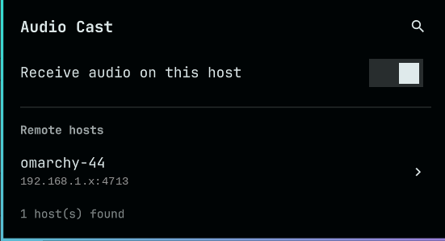
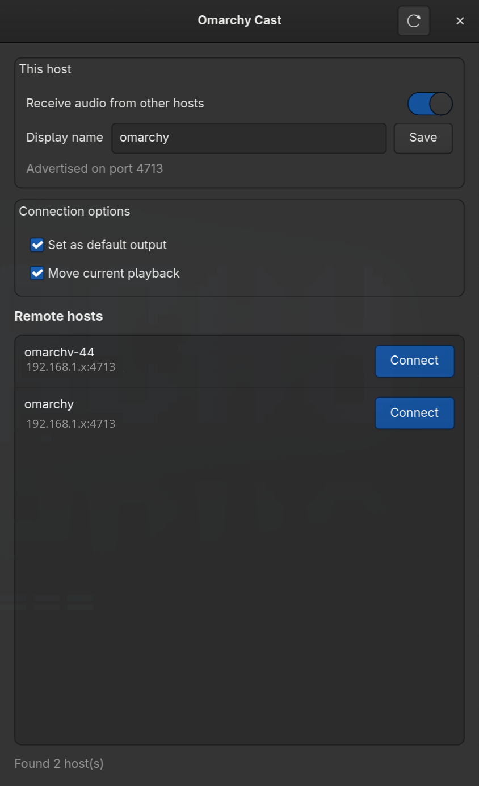

# Omarchy Cast

Cast audio from one computer to another on your local network — like AirPlay, but native to Linux/PipeWire.

投送本机音频到局域网中的另一台电脑 —— 类似 AirPlay，但基于 Linux/PipeWire 原生实现。

**English** · [中文](#中文)

---

## English

### What it is

Omarchy Cast turns any PipeWire host on your LAN into a selectable audio output of another host. On the receiving machine it advertises itself with mDNS; on the sending machine it appears as a normal output device (`Cast: <host>`), so you can route a single app or all system audio to the other computer with one command.

- Lossless PCM over the LAN (~**1.5 Mbit/s**, ≈0.15% of a gigabit link)
- Low latency (~1–3 ms on a wired LAN)
- mDNS auto-discovery — no IP addresses to remember
- CLI plus a GTK4 graphical panel
- An Omarchy bar widget (shell plugin) as a thin front end over the CLI
- No configuration files to hand-edit

### Screenshots

Omarchy bar widget (left-click the speaker icon) and the standalone GTK4 panel:

| Bar widget | Desktop panel |
|------------|---------------|
|  |  |

### How it works

```
sender                                   receiver
┌──────────────────────────┐             ┌──────────────────────────┐
│ app ─▶ omarchy_cast_<h>  │  TCP/4713   │ pipewire-pulse           │
│   (module-tunnel-sink)   ├────────────▶│ (module-native-...-tcp)  │
│                          │             │        │                 │
└──────────────────────────┘             └────────┼─────────────────┘
                                                  ▼
                                        receiver's default output
```

- The **receiver** loads PipeWire's `module-native-protocol-tcp` and publishes an mDNS service (`_omarchycast._tcp`, default port `4713`).
- The **sender** discovers it with `avahi-browse` and loads `module-tunnel-sink`, creating a virtual output device named `omarchy_cast_<host>`.
- Audio you send to that device is streamed over TCP and played on the receiver's default output.

### Requirements

- Linux with PipeWire + `pipewire-pulse` (Omarchy/Arch by default)
- `avahi` (for mDNS discovery) — `omarchy pkg add avahi`
- `python3` and `python-gobject` (GTK4 bindings are needed only for the GUI)
- `pactl` (from PipeWire/PulseAudio)

### Install

```bash
git clone https://github.com/yangkang5303/omarchy-cast.git
cd omarchy-cast
./install.sh              # installs launcher + systemd user service + desktop entry
omarchy-cast enable-receiver   # start receiving (and enable at login)
```

`./install.sh --enable` does both steps at once.

Installed files:

| Path | Purpose |
|------|---------|
| `~/.local/share/omarchy-cast/` | the program |
| `~/.local/bin/omarchy-cast` | launcher (must be on `PATH`) |
| `~/.config/systemd/user/omarchy-cast-receiver.service` | receiver service |
| `~/.local/share/applications/org.omarchy.Cast.desktop` | launcher entry |

### Usage

Discover hosts on the network:

```bash
omarchy-cast list                 # table of discovered hosts
omarchy-cast list --json          # machine-readable
```

Cast your audio to another host:

```bash
omarchy-cast connect omarchy-44            # by display name
omarchy-cast connect 192.168.1.44          # by IP
omarchy-cast connect 0                     # by index from `list`
omarchy-cast connect omarchy-44 --no-default --no-move   # don't touch current routing
```

Stop casting:

```bash
omarchy-cast disconnect omarchy-44
omarchy-cast disconnect --all
```

Receiver control:

```bash
omarchy-cast enable-receiver     # start + enable at login
omarchy-cast start-receiver      # start now
omarchy-cast stop-receiver       # stop now
omarchy-cast disable-receiver    # stop + disable
omarchy-cast receive             # run in the foreground (used by systemd)
omarchy-cast status              # show receiver + connection state
```

Restrict which remote hosts may cast to this host:

```bash
omarchy-cast allow list          # show allow mode and allowed IPs
omarchy-cast allow mode specific # only allowed IPs may cast here
omarchy-cast allow mode all      # any reachable host may cast (default)
omarchy-cast allow add 192.168.1.10     # allow one IP
omarchy-cast allow remove 192.168.1.10  # stop allowing an IP
```

When `allow mode` is `specific`, the receiver rejects connections from any
source IP that is not in the allowlist, so unallowed hosts cannot cast audio
to this machine. The receiver must be restarted for changes to take effect
(`omarchy-cast stop-receiver && omarchy-cast start-receiver`, or toggle the
panel switch).

Graphical panel:

```bash
omarchy-cast gui
```

### Omarchy integration

The installer does not modify your desktop config. To add the panel to the Omarchy menu and a keybinding, see the commands below (these are optional, manual edits).

Menu entry — add to `~/.config/omarchy/extensions/omarchy-menu.jsonc`:

```jsonc
"cast": {"icon":"󰕾","label":"Audio Cast","aliases":["cast","audio-cast"],"title":"Audio Cast"},
"cast.panel": {"icon":"󰕾","label":"Open panel","action":"uwsm-app -- \"$HOME/.local/bin/omarchy-cast\" gui"},
"cast.scan": {"icon":"󰍉","label":"Scan network","action":"omarchy-launch-floating-terminal-with-presentation omarchy-cast list"},
"cast.receive": {"icon":"󰑃","label":"Receive audio on this host","checked":"systemctl --user is-active --quiet omarchy-cast-receiver","action":"if systemctl --user is-active --quiet omarchy-cast-receiver; then omarchy-cast disable-receiver; else omarchy-cast enable-receiver; fi"},
"cast.disconnect": {"icon":"󰅖","label":"Disconnect all","action":"omarchy-cast disconnect --all"},
```

Keybinding — add to `~/.config/hypr/bindings.lua`:

```lua
o.bind("SUPER + ALT + C", "Audio Cast", "uwsm-app -- \"$HOME/.local/bin/omarchy-cast\" gui")
```

### Omarchy shell plugin

This repository doubles as an [Omarchy shell plugin](https://plugins.omarchy.org/) that puts an **Audio Cast** icon in your bar. It is a thin front end over the CLI: it runs `omarchy-cast list --json` to discover hosts, `connect`/`disconnect` to route audio, and `enable-receiver`/`disable-receiver` to toggle receiving. Install the CLI first (see [Install](#install)); the widget shows a hint when `omarchy-cast` is missing.

```bash
omarchy plugin add https://github.com/yangkang5303/omarchy-cast.git --enable
# or, if already added:
omarchy plugin enable yangkang5303.audio-cast --section right
```

- Left-click the speaker icon to open the panel; right-click to launch the GTK4 app.
- The panel lists discovered hosts (click to connect/disconnect), a switch to receive audio on this host, a "Restrict to allowed hosts" switch with an IP allowlist editor, a scan button (or press `r`), and a "disconnect all" action.

```bash
omarchy plugin disable yangkang5303.audio-cast
omarchy plugin remove yangkang5303.audio-cast
```

### Configuration

`~/.config/omarchy-cast/config.json`

| Key | Default | Meaning |
|-----|---------|---------|
| `display_name` | hostname | name other hosts see in discovery |
| `port` | `4713` | receiver TCP port |
| `auth` | `"anonymous"` | receiver auth mode (`"anonymous"` or `"cookie"`) |
| `listen` | `""` | bind address for the receiver (empty = all interfaces) |
| `allow_mode` | `"all"` | `"all"` = any reachable host may cast; `"specific"` = only `allowed_ips` |
| `allowed_ips` | `[]` | IPs allowed to cast when `allow_mode` is `"specific"` |
| `internal_port` | `0` | loopback port for the PipeWire module in `"specific"` mode (`0` = `port + 1`) |
| `set_default` | `true` | make the cast device the default output on connect |
| `move_streams` | `true` | move current playback to the cast device on connect |

```bash
omarchy-cast config                       # show current config
omarchy-cast config --set display_name "Living Room"
omarchy-cast config --set port 4713
omarchy-cast config --set listen 192.168.1.20   # bind one interface only
omarchy-cast config --set allow_mode specific
omarchy-cast config --set allowed_ips 192.168.1.10,192.168.1.11
```

### Security

- The receiver listens on TCP `4713`. PipeWire's `module-native-protocol-tcp` accepts only `port`, `listen`, and `auth-anonymous` — it has **no IP allowlist**. Anonymous mode grants unrestricted access to any client that can reach the listener, **not** just private address ranges.
- Set `listen` to your LAN address to bind a single interface, keep the receiver off on untrusted networks, restrict TCP `4713` with a host firewall, or use `"cookie"` auth for stronger control.
- The default `auth` is `anonymous`: anyone who can reach the port can use your audio server. On a trusted home LAN this is usually fine.
- If you enable `"cookie"` auth, all hosts must share the same PipeWire/Pulse cookie file.
- **IP allowlist:** set `allow_mode` to `"specific"` to restrict which remote hosts may cast to this machine. In this mode the receiver binds PipeWire to loopback and runs a small TCP proxy on the public port that accepts connections only from the IPs in `allowed_ips`; unallowed sources are rejected before they reach the audio server. This is enforced at the TCP layer, independent of `auth`. Manage it with `omarchy-cast allow ...` or the panel/GTK switch.

### Troubleshooting

| Symptom | Fix |
|---------|-----|
| `No hosts found` | Receiver not running on the other host (`enable-receiver`), or `avahi-daemon` down, or a firewall blocks UDP `5353` / TCP `4713` |
| `pactl: command not found` | Install PipeWire/pulse tooling |
| GUI does not start | Install `python-gobject` |
| Device name shows `Cast:` only | Older PipeWire mishandles spaces; this version encodes spaces as non-breaking spaces — upgrade to the latest release |
| Audio stutters | Check Wi‑Fi signal; a wired LAN is recommended for lossless PCM |

### Uninstall

```bash
omarchy-cast uninstall      # removes launcher, service, desktop entry, program files
```

### Bandwidth reference

Lossless `s16le` stereo @ 48 kHz uses about **1.5 Mbit/s** (≈662 MiB/hour). Measured overhead is under 1%.

---

## 中文

### 简介

Omarchy Cast 能把局域网内任意一台 PipeWire 主机变成另一台主机的可选音频输出设备。接收端通过 mDNS 广播自身；发送端会出现一个普通输出设备（`Cast: <主机名>`），一条命令即可把单个应用或全部系统声音投送到另一台电脑。

- 局域网内无损 PCM（约 **1.5 Mbit/s**，千兆链路占比约 0.15%）
- 低延迟（有线局域网约 1–3 ms）
- mDNS 自动发现，无需记 IP
- 提供命令行工具与 GTK4 图形面板
- 提供 Omarchy 状态栏小组件（shell 插件），作为命令行工具的轻量前端
- 无需手工编辑配置文件

### 截图

Omarchy 状态栏小组件（左键点击喇叭图标）与独立的 GTK4 面板：

| 状态栏小组件 | 桌面面板 |
|--------------|----------|
|  |  |

### 工作原理

```
发送端                                    接收端
┌──────────────────────────┐             ┌──────────────────────────┐
│ 应用 ─▶ omarchy_cast_<h> │  TCP/4713   │ pipewire-pulse           │
│   (module-tunnel-sink)   ├────────────▶│ (module-native-...-tcp)  │
│                          │             │        │                 │
└──────────────────────────┘             └────────┼─────────────────┘
                                                  ▼
                                        接收端的默认输出设备
```

- **接收端**加载 PipeWire 的 `module-native-protocol-tcp`，并通过 mDNS 发布服务（`_omarchycast._tcp`，默认端口 `4713`）。
- **发送端**用 `avahi-browse` 发现它，加载 `module-tunnel-sink`，生成名为 `omarchy_cast_<主机>` 的虚拟输出设备。
- 发往该设备的音频经 TCP 传输，在接收端由默认输出设备播放。

### 环境要求

- Linux + PipeWire + `pipewire-pulse`（Omarchy/Arch 默认具备）
- `avahi`（用于 mDNS 发现）—— `omarchy pkg add avahi`
- `python3` 与 `python-gobject`（仅图形界面需要 GTK4 绑定）
- `pactl`（来自 PipeWire/PulseAudio）

### 安装

```bash
git clone https://github.com/yangkang5303/omarchy-cast.git
cd omarchy-cast
./install.sh                    # 安装启动器 + systemd 用户服务 + 桌面项
omarchy-cast enable-receiver    # 开始接收（并设为开机自启）
```

`./install.sh --enable` 可一步完成以上两步。

安装位置：

| 路径 | 用途 |
|------|------|
| `~/.local/share/omarchy-cast/` | 程序本体 |
| `~/.local/bin/omarchy-cast` | 启动器（需在 `PATH` 中） |
| `~/.config/systemd/user/omarchy-cast-receiver.service` | 接收服务 |
| `~/.local/share/applications/org.omarchy.Cast.desktop` | 桌面启动项 |

### 使用

发现局域网内的主机：

```bash
omarchy-cast list                 # 表格列出
omarchy-cast list --json          # JSON 输出
```

投送音频到另一台主机：

```bash
omarchy-cast connect omarchy-44            # 按显示名
omarchy-cast connect 192.168.1.44          # 按 IP
omarchy-cast connect 0                     # 按 `list` 中的序号
omarchy-cast connect omarchy-44 --no-default --no-move   # 不改动当前路由
```

停止投送：

```bash
omarchy-cast disconnect omarchy-44
omarchy-cast disconnect --all
```

接收端控制：

```bash
omarchy-cast enable-receiver     # 启动并设为开机自启
omarchy-cast start-receiver      # 立即启动
omarchy-cast stop-receiver       # 立即停止
omarchy-cast disable-receiver    # 停止并取消自启
omarchy-cast receive             # 前台运行（systemd 使用）
omarchy-cast status              # 查看接收端与连接状态
```

限制哪些远程主机可以向本机投送音频：

```bash
omarchy-cast allow list          # 查看允许模式与已允许的 IP
omarchy-cast allow mode specific # 仅允许列表中的 IP 投送
omarchy-cast allow mode all      # 允许任意可达主机投送（默认）
omarchy-cast allow add 192.168.1.10     # 允许某个 IP
omarchy-cast allow remove 192.168.1.10  # 取消允许某个 IP
```

当 `allow mode` 为 `specific` 时，接收端会拒绝所有不在允许列表中的来源 IP，
未获允许的主机无法向本机投送音频。修改后需重启接收端才能生效
（`omarchy-cast stop-receiver && omarchy-cast start-receiver`，或切换面板开关）。

图形面板：

```bash
omarchy-cast gui
```

### Omarchy 集成

安装脚本不会改动你的桌面配置。如需把面板加入 Omarchy 菜单或设置快捷键，请手动添加以下内容（可选）。

菜单项 —— 追加到 `~/.config/omarchy/extensions/omarchy-menu.jsonc`：

```jsonc
"cast": {"icon":"󰕾","label":"Audio Cast","aliases":["cast","audio-cast"],"title":"Audio Cast"},
"cast.panel": {"icon":"󰕾","label":"Open panel","action":"uwsm-app -- \"$HOME/.local/bin/omarchy-cast\" gui"},
"cast.scan": {"icon":"󰍉","label":"Scan network","action":"omarchy-launch-floating-terminal-with-presentation omarchy-cast list"},
"cast.receive": {"icon":"󰑃","label":"Receive audio on this host","checked":"systemctl --user is-active --quiet omarchy-cast-receiver","action":"if systemctl --user is-active --quiet omarchy-cast-receiver; then omarchy-cast disable-receiver; else omarchy-cast enable-receiver; fi"},
"cast.disconnect": {"icon":"󰅖","label":"Disconnect all","action":"omarchy-cast disconnect --all"},
```

快捷键 —— 追加到 `~/.config/hypr/bindings.lua`：

```lua
o.bind("SUPER + ALT + C", "Audio Cast", "uwsm-app -- \"$HOME/.local/bin/omarchy-cast\" gui")
```

### Omarchy 状态栏插件

本仓库同时是一个 [Omarchy shell 插件](https://plugins.omarchy.org/)，会在状态栏放置一个 **Audio Cast** 图标。它是命令行工具的轻量前端：调用 `omarchy-cast list --json` 发现主机、用 `connect`/`disconnect` 投送或停止音频、用 `enable-receiver`/`disable-receiver` 开关本机接收。请先安装命令行工具（见[安装](#安装)）；若缺少 `omarchy-cast`，组件会给出提示。

```bash
omarchy plugin add https://github.com/yangkang5303/omarchy-cast.git --enable
# 或已添加过插件时：
omarchy plugin enable yangkang5303.audio-cast --section right
```

- 左键点击喇叭图标打开面板；右键启动 GTK4 图形界面。
- 面板列出发现的主机（点击连接/断开）、本机接收开关、“仅允许指定主机”开关及 IP 白名单编辑、扫描按钮（或按 `r`），以及“全部断开”操作。

```bash
omarchy plugin disable yangkang5303.audio-cast
omarchy plugin remove yangkang5303.audio-cast
```

### 配置

`~/.config/omarchy-cast/config.json`

| 键 | 默认值 | 含义 |
|----|--------|------|
| `display_name` | 主机名 | 其他主机在发现时看到的名字 |
| `port` | `4713` | 接收端 TCP 端口 |
| `auth` | `"anonymous"` | 接收端认证方式（`"anonymous"` 或 `"cookie"`） |
| `listen` | `""` | 接收端绑定地址（留空表示所有网卡） |
| `allow_mode` | `"all"` | `"all"` = 任意可达主机可投送；`"specific"` = 仅 `allowed_ips` |
| `allowed_ips` | `[]` | `allow_mode` 为 `"specific"` 时允许投送的 IP 列表 |
| `internal_port` | `0` | `"specific"` 模式下 PipeWire 模块的回环端口（`0` = `port + 1`） |
| `set_default` | `true` | 连接时把投送设备设为默认输出 |
| `move_streams` | `true` | 连接时把当前播放迁移到投送设备 |

```bash
omarchy-cast config                       # 查看当前配置
omarchy-cast config --set display_name "客厅"
omarchy-cast config --set port 4713
omarchy-cast config --set listen 192.168.1.20   # 仅绑定单个网卡
omarchy-cast config --set allow_mode specific
omarchy-cast config --set allowed_ips 192.168.1.10,192.168.1.11
```

### 安全

- 接收端监听 TCP `4713`。PipeWire 的 `module-native-protocol-tcp` 只接受 `port`、`listen` 与 `auth-anonymous`，**没有 IP 白名单**。匿名模式会对任何能连到该端口的客户端授予无限制访问，**并不限于私网地址段**。
- 可把 `listen` 设为本机局域网地址以只绑定单个网卡；在不可信网络中关闭接收端；用主机防火墙限制 TCP `4713`；或改用 `"cookie"` 认证以获得更强的控制。
- 默认 `auth` 为 `anonymous`：任何能访问该端口的主机都能使用你的音频服务。在可信的家庭局域网中通常没问题。
- 若启用 `"cookie"` 认证，所有主机需共享同一份 PipeWire/Pulse cookie 文件。
- **IP 白名单：** 将 `allow_mode` 设为 `"specific"` 可限制哪些远程主机能向本机投送。此模式下接收端把 PipeWire 绑定到回环地址，并在公共端口上运行一个小的 TCP 代理，只接受 `allowed_ips` 中 IP 的连接；未获允许的来源在到达音频服务之前即被拒绝。该限制在 TCP 层生效，与 `auth` 无关。可通过 `omarchy-cast allow ...` 或面板/GTK 开关管理。

### 常见问题

| 现象 | 处理 |
|------|------|
| `No hosts found` | 对方接收端未运行（`enable-receiver`），或 `avahi-daemon` 未启动，或防火墙拦截了 UDP `5353` / TCP `4713` |
| `pactl: command not found` | 安装 PipeWire/PulseAudio 工具 |
| 图形界面无法启动 | 安装 `python-gobject` |
| 设备名只显示 `Cast:` | 旧版 PipeWire 对空格处理有问题；本版本已将空格编码为不换行空格，升级到最新版即可 |
| 声音卡顿 | 检查 Wi‑Fi 信号；无损 PCM 建议使用有线局域网 |

### 卸载

```bash
omarchy-cast uninstall      # 移除启动器、服务、桌面项与程序文件
```

### 带宽参考

无损 `s16le` 立体声 @ 48 kHz 约 **1.5 Mbit/s**（约 662 MiB/小时），实测协议开销低于 1%。
